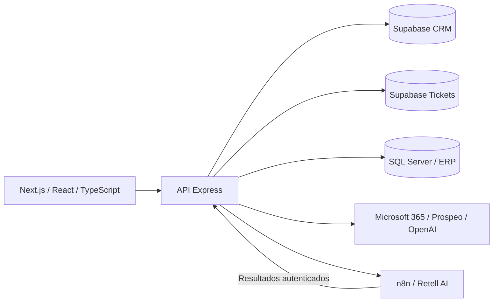

# Portal DAVOFRIO

[](https://github.com/SantiagoAR7/crm-comercial-ia/actions/workflows/ci.yml)

**CRM, automatización e inteligencia de negocio para operaciones de climatización.**

Aplicación web que reúne campañas comerciales con aprobación humana, prospección, consulta del ERP, seguimiento de publicaciones y revisión de tickets. Su objetivo es reducir los pasos manuales entre la información operativa y las acciones del equipo, conservando separación de accesos y trazabilidad.

El repositorio contiene el frontend, la API y parte de las migraciones. Los flujos de n8n, los datos del ERP y la configuración de proveedores se administran por separado. **No incluye una demo pública con datos ficticios ni un despliegue autónomo listo para usar.**

## Recorrido de revisión

- [Módulos y comportamiento funcional](docs/MODULES.md)
- [Arquitectura y decisiones técnicas](docs/ARCHITECTURE.md)
- [Instalación y configuración](docs/SETUP.md)
- [Pruebas y alcance de CI](docs/TESTING.md)
- [Trabajo pendiente](docs/ROADMAP.md)
- [Seguridad](SECURITY.md) y [contribuciones](CONTRIBUTING.md)

## Qué resuelve

| Área | Funcionalidad | Control relevante |
| --- | --- | --- |
| CRM y campañas | Filtrar instalaciones, revisar candidatos y enviar campañas a n8n/Retell | Aprobación humana y deduplicación por teléfono |
| Prospección IA | Listas, enriquecimiento, ideas y seguimiento por email | Activación y límites de envío por configuración |
| Business Intelligence | Consultar métricas del ERP en SQL Server | Credenciales exclusivamente en backend |
| Redes | Consultar evidencias de publicaciones conservadas en n8n | Sincronización observacional |
| Facturas y tickets | Revisar evidencias y aprobar o rechazar documentos | Sesión y Supabase independientes; exportaciones con checkpoints |

El portal `/` presenta los módulos. Las áreas protegidas tienen entradas independientes: `/login`, `/prospeccion-login`, `/bi-login`, `/redes/login` y `/facturas/login`.

## Arquitectura



Las integraciones sensibles se ejecutan en el backend. La interfaz utiliza cookies `HttpOnly`; la API valida firma, caducidad y área de acceso. Las campañas se revisan antes de ejecutarse y sus resultados se registran mediante callbacks.

## Tecnologías

- **Interfaz:** Next.js, React, TypeScript y Tailwind CSS.
- **API:** Node.js, Express y pruebas con `node:test`.
- **Datos:** Supabase/PostgreSQL y SQL Server.
- **Integraciones:** n8n, Retell AI, Microsoft 365, Prospeo y OpenAI.
- **Entrega:** Docker Compose, proxy inverso y GitHub Actions.

## Verificar el código

Con Node.js 22.12+ y npm, desde la raíz:

```bash
npm ci --prefix backend
npm ci --prefix frontend
npm test
npm run check:secrets
npm run build
```

Las pruebas usan datos ficticios, dobles de base de datos y servidores HTTP locales. No arrancan los workers de producción ni necesitan credenciales reales. La compilación del frontend tampoco requiere acceso al ERP. Consulta [TESTING.md](docs/TESTING.md) para conocer los límites de estos controles.

Para iniciar la aplicación completa, sigue [SETUP.md](docs/SETUP.md). Copiar las plantillas `.env` no basta: la API necesita un Supabase configurado y faltan las migraciones iniciales del CRM en este repositorio.

## Estructura

```text
backend/
  src/routes/       Endpoints HTTP por dominio
  src/services/     Autenticación y lógica de integración
  test/            Pruebas de regresión e integración local
frontend/
  app/             Rutas y páginas de los módulos
  components/      Componentes compartidos
  lib/             Cliente de API
supabase/          Migraciones disponibles y requisitos de esquema
docs/              Arquitectura, operación y verificación
scripts/           Utilidades de revisión y datos de demostración
.github/workflows/ Verificación automática
```

## Decisiones que conviene revisar

1. **API y proveedores:** el navegador no necesita las claves operativas.
2. **Campañas:** los contactos incluidos deben aprobarse antes de lanzar llamadas.
3. **Tickets:** credenciales, cookie y base de datos propias para esa área.
4. **Exportaciones:** checkpoints y reserva de filas para reanudar tareas sin repetir escrituras completadas.
5. **Resultados de llamadas:** cola, estados y reintentos limitados para resultados transitorios.

## Límites y siguientes mejoras

- Completar el esquema inicial y una demo independiente de servicios privados.
- Extender las pruebas a campañas, concurrencia, reintentos y errores de proveedores.
- Dividir los archivos grandes de prospección en componentes y servicios menores.
- Uniformar la captura de errores asíncronos de las rutas Express.
- Añadir una demostración visual anonimizada y métricas de impacto verificadas.

La configuración de producción es específica de DAVOFRIO. Este repositorio público no implica acceso autorizado a sus servicios. No se ha añadido una licencia de reutilización: los permisos de distribución deben confirmarse con sus titulares.
